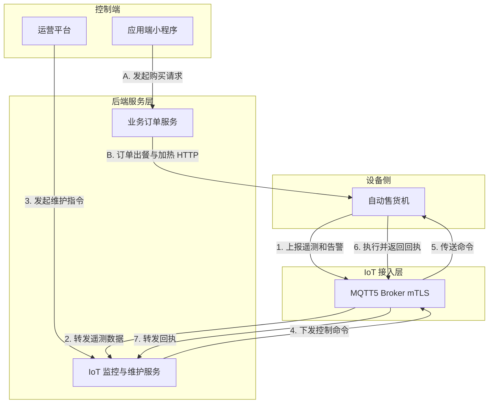

import { CardGrid, LinkCard } from "@astrojs/starlight/components";

## 概览

MQTT5 用于设备侧长连接：自动售货机上报冰柜、货道、微波炉、门锁、控制板和网络状态；运营平台下发远程维护命令。订单创建、支付、出餐和加热任务由业务 HTTP 服务发起，MQTT5 只负责设备监控与维护通道。

### 监控与维护架构示意图

## 章节

<CardGrid>
	<LinkCard
		title="连接"
		href="/mqtt5/connection/"
		description="Broker、mTLS、Client ID、会话和证书绑定规则。"
	/>
	<LinkCard
		title="主题约定"
		href="/mqtt5/topics/"
		description="设备遥测、状态、库存、告警和维护 topic 约定。"
	/>
	<LinkCard
		title="遥测"
		href="/mqtt5/telemetry/"
		description="遥测 payload、retained status 和库存快照结构。"
	/>
	<LinkCard
		title="远程维护"
		href="/mqtt5/maintenance/"
		description="远程诊断、禁售、开锁、升级命令和执行回执。"
	/>
	<LinkCard
		title="可靠性"
		href="/mqtt5/reliability/"
		description="LWT、QoS、retained 消息、过期命令和幂等规则。"
	/>
</CardGrid>

## 集成边界

- MQTT5 承载设备监控与维护，不承载应用端订单状态同步。
- 应用端实时同步使用 [WebSocket](/websocket/)。
- 运营后台事件流使用 [SSE](/sse/)。
