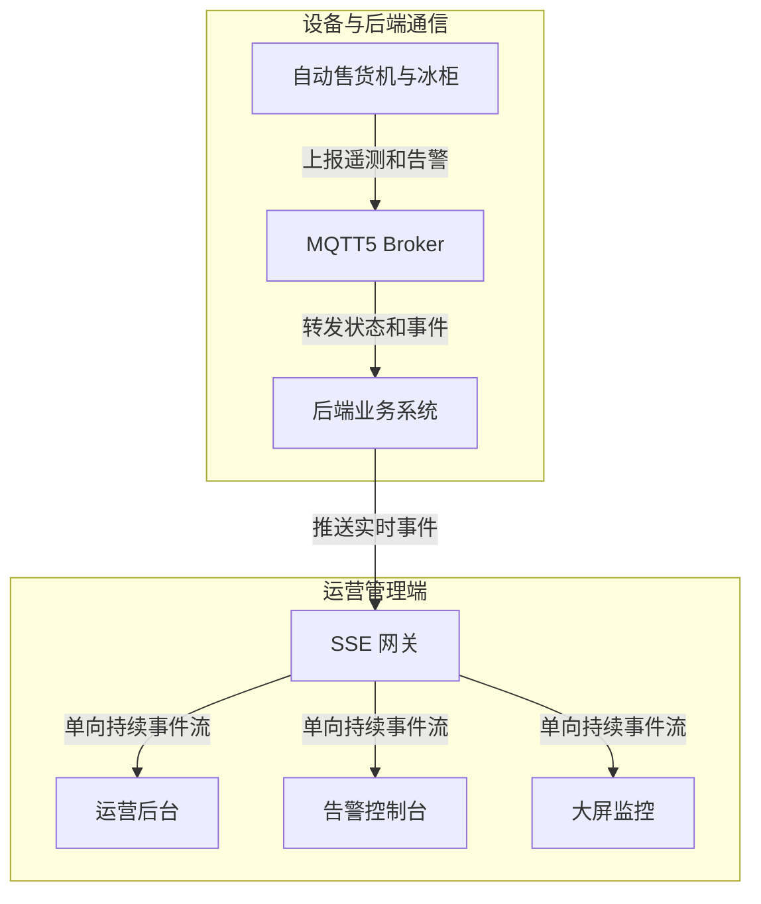

import { CardGrid, LinkCard } from "@astrojs/starlight/components";

## 概览

SSE 用于运营后台、告警控制台和大屏监控。它是服务端到浏览器的单向事件流，适合观察全局设备状态、库存低水位、温控异常、出餐失败和维护结果。

设备不上行 SSE，应用端订单同步也不使用 SSE。设备使用 MQTT5，应用端使用 WebSocket。

### 数据流向示意图



### D2 示意图 (标准矢量样式)

```d2
x: 售货机设备 -> y: 边缘网关: MQTT5 上报
y -> z: 运营中心: SSE 实时推送
```

### D2 手绘草图 (Sketch 模式)

```d2 sketch
x: 售货机设备 -> y: 边缘网关: MQTT5 上报
y -> z: 运营中心: SSE 实时推送
```

## 章节

<CardGrid>
	<LinkCard
		title="端点"
		href="/sse/endpoint/"
		description="运营事件流地址、鉴权请求头和过滤参数。"
	/>
	<LinkCard
		title="事件"
		href="/sse/events/"
		description="事件格式、事件类型和完整 stream 示例。"
	/>
	<LinkCard
		title="重连"
		href="/sse/reconnect/"
		description="Last-Event-ID、retry、心跳和至少一次投递规则。"
	/>
	<LinkCard
		title="错误"
		href="/sse/errors/"
		description="鉴权过期和错误事件处理方式。"
	/>
</CardGrid>
